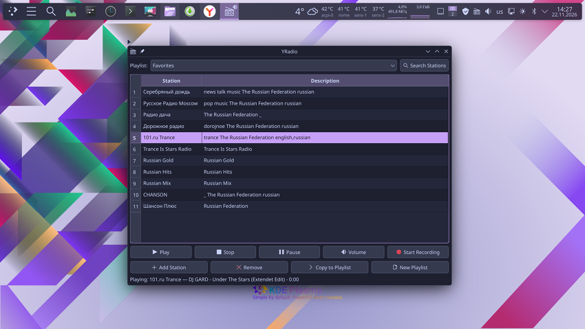

# YRadio-Qt





### Dependencies:

```
# Void-linux
sudo xbps-install -S mpv alsa-utils pulseaudio-utils python3 python3-pyside6
```

```
# Arch-linux
sudo pacman -Syu mpv alsa-utils libpulse pipewire-pulse python pyside6
```

### Using YRadio:

- Select station: click on it twice or highlight and click Play.
- Find a station: click Search Stations, select a country and/or enter a station name or tag. Select a result and click Add Selected, to save a station to the current playlist.
- Manage playlists: select a playlist from the list above. Buttons allow you to add or remove a station, create a playlist and copy a station to another playlist.
- Select player: right click on the YRadio icon in the system tray, open Select player (mpv or mplayer) and select the installed player. The selection is applied the next time the station is started.
- Pause, volume and stop: use the buttons in the program window or the corresponding menu items of the tray icon.
- Record: start the station and press Start Recording. Required for registration mpv and file yradio_ripper.lua next to the program. When you first start recording, select a folder for the files.
